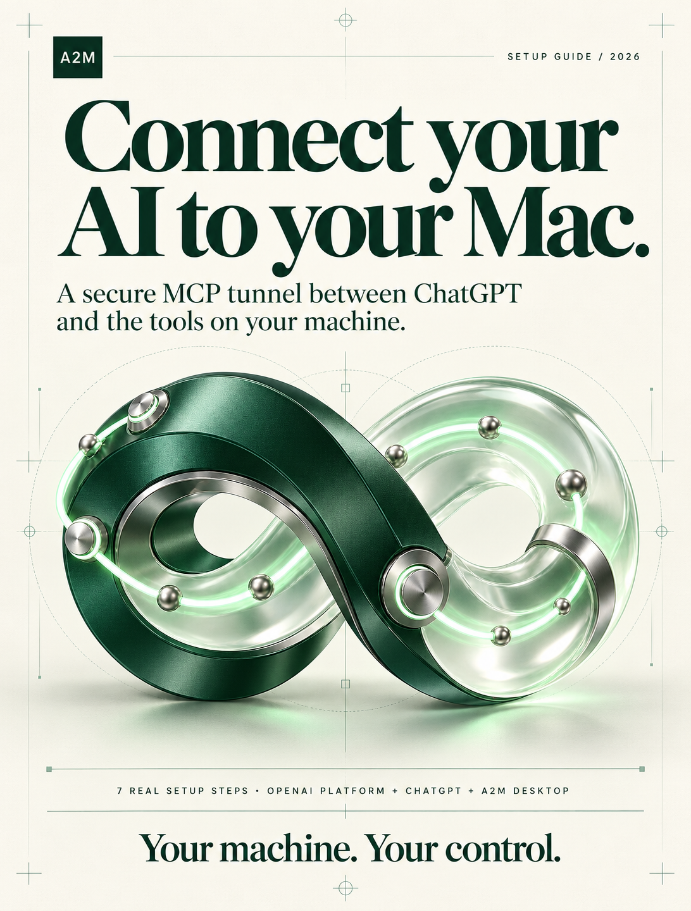
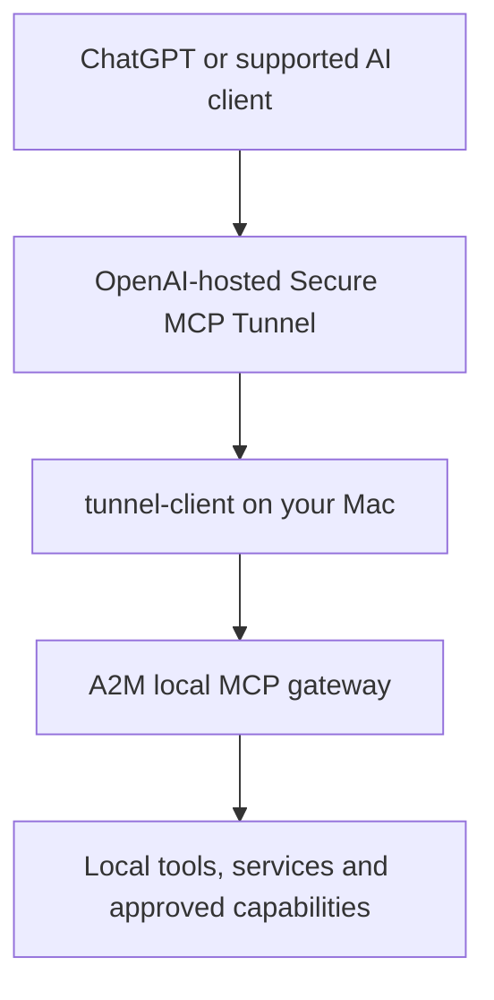

# A2M | Agent to Machine

### Your AI client, connected to the tools already on your computer.



**New to A2M?** Start with the [seven-step visual setup guide](docs/ONBOARDING.md). It includes actual, privacy-redacted screenshots of OpenAI Platform, ChatGPT Plugins and A2M Desktop, all supplied as PNG images.

A2M is a local **Model Context Protocol (MCP) bridge**. It lets an MCP-compatible AI client discover and invoke machine-local development capabilities, while you control the connection from a native macOS desktop app.

**A2M is not another AI model or autonomous coding agent.** The AI client decides what to do. A2M provides the MCP interface, runtime, process supervision and local capability boundaries used to carry out approved work.

> **Release status:** Pre-release source build. The first public DMG will be offered after clean-machine installation, signing/notarization and end-to-end verification. Do not assume a build produced on one Mac will work on every Mac.

## What A2M can do

| Capability | What it provides |
| --- | --- |
| Files and projects | Native Rust file operations, paginated reads, directory search and targeted edits |
| Terminal and processes | Commands, long-running sessions, output capture, process monitoring and termination controls |
| Documents | Go-powered PDF reading and DOCX / XLSX tools |
| Code understanding | Optional access to a locally installed Code Review Graph MCP, using that tool's actual parser and schema |
| Installed skills | Discover local skill metadata and read approved `SKILL.md` files. Skills are **not** silently executed |
| Third-party MCP tools | Discover configured servers and expose only tools explicitly approved for passthrough |
| Desktop control | Connect / Disconnect, local status, activity and live process monitoring |

The number of visible MCP tools **depends on what is actually installed and permitted**. A list of tools is not proof that every tool can run. Verify a representative invocation from your intended AI client.

## How the private ChatGPT connection works



The local MCP gateway does not need an inbound public internet port. `tunnel-client` initiates an **outbound HTTPS** connection to OpenAI and forwards the MCP traffic to your local gateway. This is a private OpenAI-hosted relay, not a direct peer-to-peer tunnel. You create the tunnel and supply your own runtime key. See the [official Secure MCP Tunnel guide](https://developers.openai.com/api/docs/guides/secure-mcp-tunnels).

## Requirements

- **macOS 12+ on Apple Silicon** for the current desktop build script. Intel macOS, Windows and Linux desktop releases are not yet validated.
- For building from source: Xcode Command Line Tools (`swiftc`, `codesign`, `hdiutil`), **Go 1.24+** and a recent stable **Rust/Cargo** toolchain.
- For a private OpenAI connection: your own OpenAI Platform organization/project, a `tunnel_id`, a restricted runtime API key and permission to add a custom MCP connection to your ChatGPT workspace.
- The official [`tunnel-client`](https://github.com/openai/tunnel-client), installed on the same Mac and reachable from A2M.

### Option A: install a published desktop release (when available)

1. Open the repository's **Releases** section and download the macOS ARM64 `.dmg` published by the maintainer.
2. Mount it, move **A2M.app** to **Applications**, and launch A2M Desktop.
3. Follow [OpenAI tunnel onboarding](docs/ONBOARDING.md), configure credentials through the app setup when available, and select **Connect machine**.
4. Verify tool discovery and a **safe read-only MCP tool call** from the intended ChatGPT workspace.

Do not download installers from unrelated websites. Until a release is signed with a Developer ID certificate and notarized by Apple, macOS may warn about or block the build. An ad-hoc signature is **not** a notarized public release.

For testers, the [GitHub Actions workflow](https://github.com/imMamdouhaboammar/a2m/actions/workflows/ci.yml) also provides an **unnotarized developer-preview DMG** as a short-lived artifact from the macOS job when CI passes. It is for development evaluation, may require a GitHub sign-in to download, and is **not a general-public installer**. Verify its provenance and do not disable macOS protections to run untrusted downloads.

### Option B: build from source

```bash
git clone https://github.com/imMamdouhaboammar/a2m.git
cd a2m

# Build the Rust/Go services and local CLI.
make build

# Build the Cocoa desktop bundle and local macOS DMG.
./scripts/build_desktop.sh

# Launch the generated app locally.
open apps/desktop/macos/A2M.app
```

The build scripts derive their project root from the script location; they should not require the maintainer's filesystem paths. The desktop build currently creates an **ad-hoc signed** local app for development and testing, not a notarized installer.

To verify the engine tests from a clean source checkout:

```bash
make test
```

`make test` builds the required binaries before running the Rust and Go suites. The generated CLI is under `bin/a2m`.

### Configure the OpenAI tunnel

1. Create your own tunnel under [OpenAI Platform / Tunnels](https://platform.openai.com/settings/organization/tunnels). Associate it with the correct Platform organization **and ChatGPT workspace**.
2. Copy the full tunnel ID that begins with `tunnel_`.
3. Create an appropriate **runtime** secret key under [OpenAI Platform / API keys](https://platform.openai.com/settings/organization/api-keys). Keep it local and grant only the permissions needed for tunnel use.
4. At [ChatGPT Plugins](https://chatgpt.com/plugins), choose **Add → Add custom MCP server → Tunnel**, then select or paste your tunnel ID. Configure any additional MCP authentication separately.
5. In A2M Desktop, provide the local runtime credential in **Settings** if supported by your build. For source/developer setups only, create a private `.env` from `.env.example`:

```dotenv
TUNNEL_ID=tunnel_REPLACE_WITH_YOURS
CONTROL_PLANE_API_KEY=sk-REPLACE_WITH_YOURS
A2M_GATEWAY_PORT=8765
```

Do **not** commit the `.env` file. Avoid placing a real key in terminal logs, screenshots, bug reports or chat. The desktop can use the macOS Keychain for the runtime secret.

See **[the illustrated seven-step onboarding](docs/ONBOARDING.md)** for the full flow. A source-build example may require the `A2M_IPC_SOCKET` setting; consult your checked-out `.env.example` and allow user-specific paths.

## Confirm that it works

After pressing **Connect machine**, verify all of the following:

1. The local A2M gateway responds on `127.0.0.1:8765`.
2. `tunnel-client` is **ready and polling**, not just installed.
3. Your ChatGPT custom MCP connection discovers the available tools.
4. A harmless read-only MCP call succeeds end to end.

For a separately managed tunnel-client profile, run:

```bash
tunnel-client doctor --profile YOUR_PROFILE --explain
```

If the desktop window is blank, inspect frontend/WebView errors. An online HTTP gateway does not guarantee the native desktop view is healthy. If ChatGPT shows tools but a call fails, check the tunnel-client profile, worker process and permissions.

## Security and privacy

- The local gateway should bind to loopback by default. Do not make it remotely reachable without explicit authentication and a security review.
- Keep OpenAI API keys in the macOS Keychain or an untracked private runtime environment, never source control.
- Local skills and third-party MCPs are **discovered first**, with execution/passthrough subject to specific approval. Discovery alone grants no execution permission.
- Use dedicated workspaces and least-privilege access when an AI client can run terminal commands and edit files.
- Do not publish machine logs, tunnel-client profiles, generated app bundles, caches or working copies of private repositories.
- The OpenAI tunnel is intended for **private MCP connections**. OpenAI does not support public plugin submission through the secure tunnel path. Public distribution of A2M's source/application is separate: every user connects their own private tunnel.

Report security concerns privately using the instructions in [SECURITY.md](SECURITY.md).

## Architecture and contributor docs

- Native macOS launcher: `apps/desktop/macos/main.swift`
- Desktop UI: `UI/a2m-desktop-v2/`
- Go MCP gateway and process/connection management: `services/dc-gateway/`
- Rust file/search engine: `services/dc-fs-engine/`
- Go document service: `services/dc-doc-service/`
- Developer build and release scripts: `build.sh`, `scripts/`
- Capability model and current limitations: `docs/capability-bridge.md`

Contributions and bug reports: [CONTRIBUTING.md](CONTRIBUTING.md).

## Credit and license

A2M was inspired in part by the workflow of [Desktop Commander MCP](https://github.com/wonderwhy-er/DesktopCommanderMCP). A2M's implementation and product architecture are separate; all applicable third-party copyright notices and dependency licenses must be respected.

The source tree currently includes the **Apache License 2.0**; see [LICENSE](LICENSE). Copyright and attribution remain with their respective authors. The maintained A2M project is led by **Mamdouh Aboammar**.
