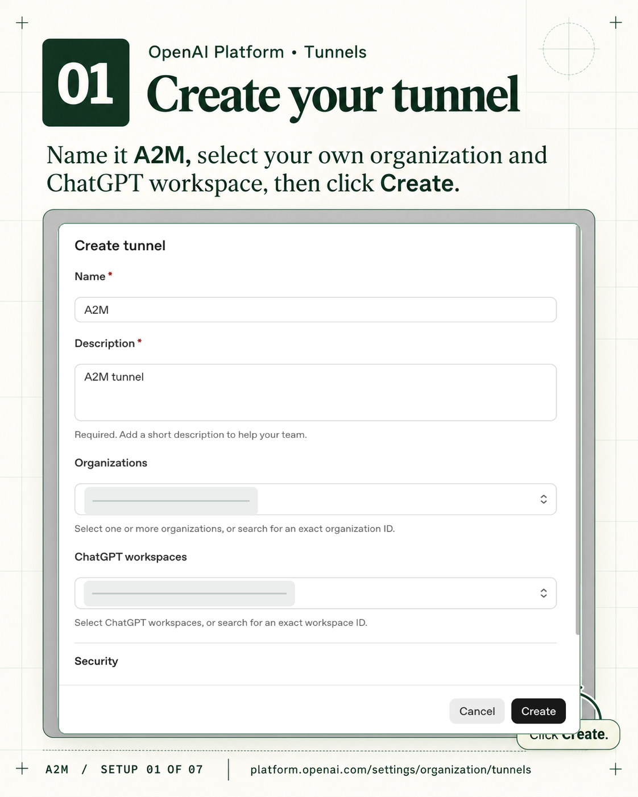
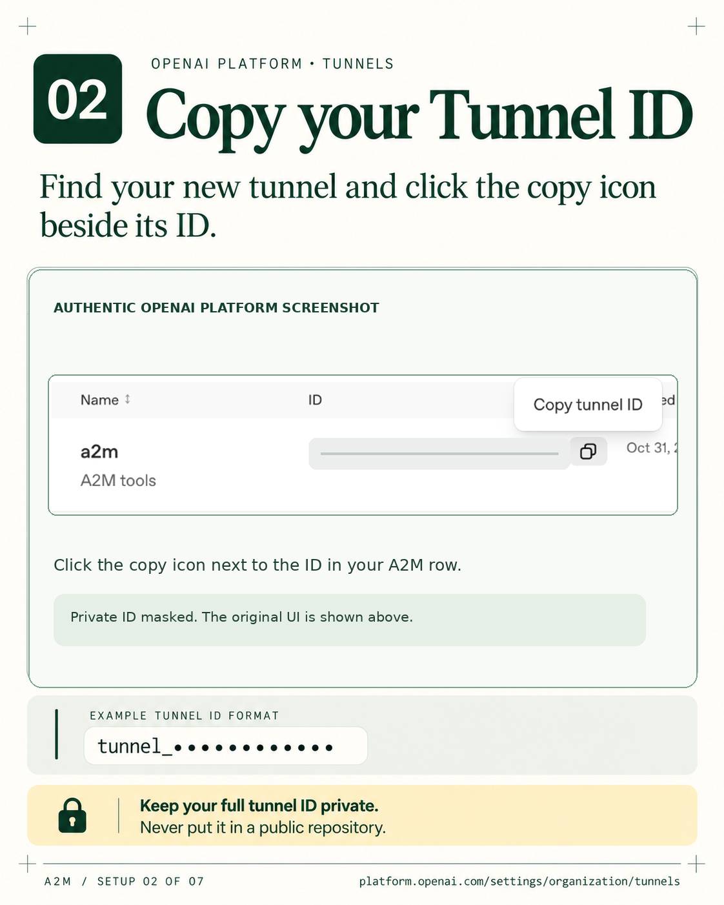
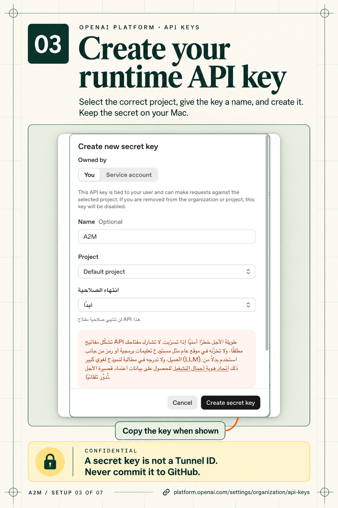
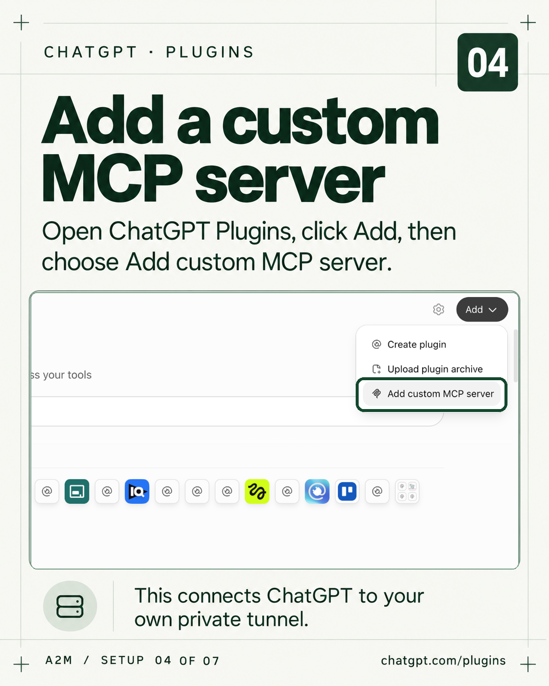
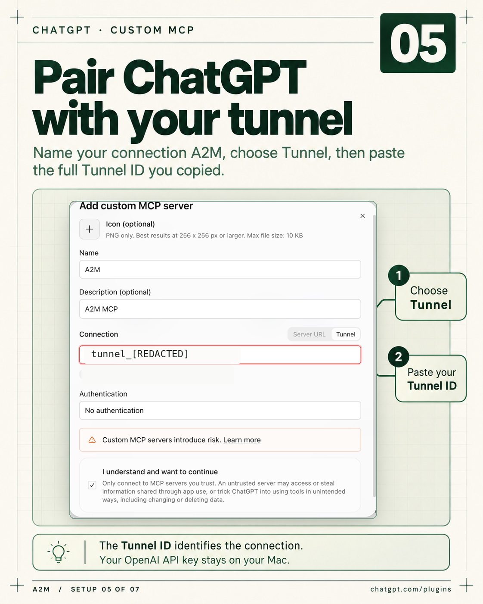
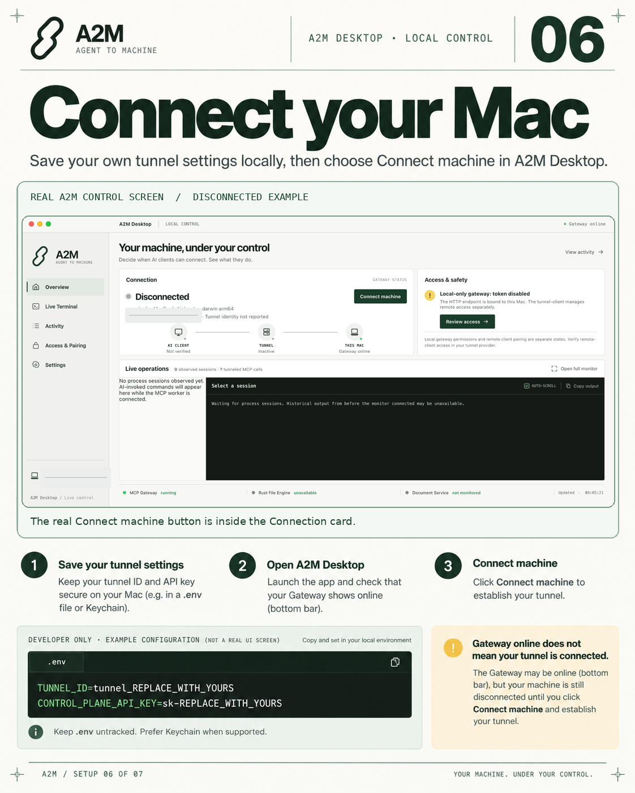
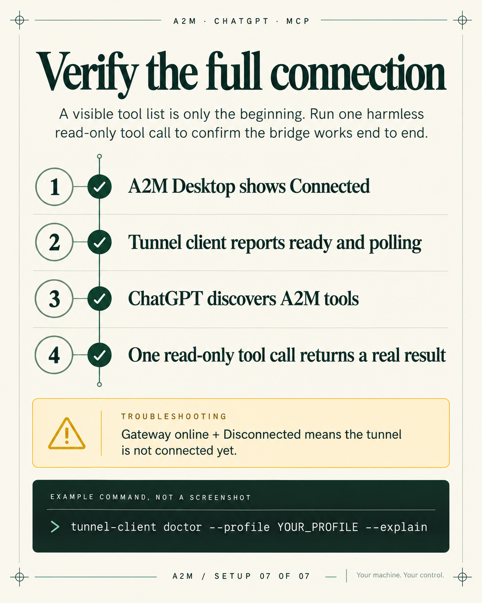

# A2M setup: connect ChatGPT to your own machine

> This guide uses **eight PNG images only**: a cover, six steps with real OpenAI/ChatGPT/A2M screenshots, and a final verification checklist. Real account identifiers and hostnames have been redacted. Illustrated examples are labeled as such; no real key is shown.


A2M runs an MCP gateway on your own computer. OpenAI Secure MCP Tunnel makes that **private** gateway available to supported OpenAI clients through an **outbound HTTPS connection to OpenAI**, without a public inbound port. The gateway, `tunnel-client`, and ChatGPT's custom MCP connection are distinct parts of this setup.

**Before you begin:** install a supported A2M desktop build or prepare a source build according to this repository's installation guide. Have permission to create/use tunnels in your OpenAI Platform organization and to add a custom MCP server in the target ChatGPT workspace. OpenAI Platform API access is separate from a ChatGPT subscription.

## 1. Create a private tunnel

Open [OpenAI Platform / Tunnels](https://platform.openai.com/settings/organization/tunnels) and select **Create tunnel**. Enter a name such as `A2M` and a short description. Associate the tunnel with the **Platform organization** that owns it and the **ChatGPT workspace** in which you will use it.



Creating or editing tunnels requires **Tunnels: Read + Manage** permissions. Running a tunnel and selecting it in a connector requires **Tunnels: Read + Use**. An administrator may need to grant access.

## 2. Copy your Tunnel ID

Find the tunnel you just created and use its copy button. It will look like `tunnel_...`. Keep the **complete** ID for the ChatGPT connection and local A2M configuration.



The tunnel ID identifies the connection. It is **not** an API key. Do not reuse the example ID from a screenshot.

## 3. Create a runtime API key

Open [OpenAI Platform / API keys](https://platform.openai.com/settings/organization/api-keys), choose **Create new secret key**, give it an identifiable name such as `A2M`, select the appropriate project and access scope, and save the resulting `sk-...` value **securely**. You may not be able to view it again after closing the dialog.



The runtime key authenticates the local `tunnel-client` to OpenAI. Give it only the permissions it needs, with **Tunnels: Read + Use** granted as required. Use a suitably restricted or service-account key where your organization supports it. Do not paste a live key into ChatGPT, a GitHub issue, or a public screenshot.

## 4. Add a custom MCP server in ChatGPT

Visit [ChatGPT / Plugins](https://chatgpt.com/plugins) and choose **Add → Add custom MCP server**.



## 5. Pair it with the tunnel

Give the MCP server a name (for example `A2M`), select **Tunnel** in the connection selector, then select your tunnel or paste its complete `tunnel_...` ID. Configure any separate MCP-level authentication required by your local gateway, review the security warning, and create the custom MCP server.



**Important:** The ChatGPT-side MCP authentication setting and the local `CONTROL_PLANE_API_KEY` are different concerns. The runtime OpenAI key remains on your own machine. If your tunnel is absent from the picker, first check workspace association and permissions.

## 6. Configure A2M and connect your Mac

For a **developer/source installation**, start with this repository's `.env.example` and copy it to an untracked local `.env`. Populate the values you created above:

```dotenv
TUNNEL_ID=tunnel_REPLACE_WITH_YOURS
CONTROL_PLANE_API_KEY=sk-REPLACE_WITH_YOURS
A2M_GATEWAY_PORT=8765
# Configure A2M_IPC_SOCKET only if your build requires an explicit path.
```

Never copy placeholder credentials verbatim into production. The secret must not appear in a public file or a logged command. Confirm the exact variable names against the A2M version you installed. **Packaged desktop distributions may use an app setup screen and the macOS Keychain instead of a developer `.env`; follow that build's installer guidance.** Paths should be resolved from each user's installation and runtime environment rather than from the author's home directory.



The screenshot shows the **actual A2M Desktop interface in its disconnected state**, not a successful tunnel connection. The `.env` example below it is an illustration, not a screenshot of private settings. Click **Connect machine** after configuring your own runtime credentials.

If you are managing `tunnel-client` yourself, validate its real profile with:

```bash
tunnel-client doctor --profile YOUR_PROFILE --explain
```

Keep `tunnel-client` running while using the MCP connection. A2M builds that control the tunnel from their desktop **Connect** button can manage that process on your behalf; verify actual process health rather than assuming the click succeeded.

## 7. Connect and verify an MCP tool call

Open **A2M Desktop** and click **Connect machine**. Confirm the local gateway is healthy, the tunnel-client is ready and polling, and ChatGPT can discover tools. Invoke a **harmless read-only MCP tool** and confirm a successful response.



This image is a **verification checklist, not a screenshot of a successful run**. Check each item against your own machine and ChatGPT session before you consider the bridge ready.

An online gateway or green UI indicator is **not sufficient** proof of end-to-end connectivity. Confirm a real call from the intended ChatGPT workspace. To disconnect, use the A2M control and verify the tunnel state actually changes.

### If something does not connect

| Symptom | Check |
| --- | --- |
| Tunnel missing in ChatGPT | Correct ChatGPT workspace association and **Tunnels: Read + Use** permission |
| `CONTROL_PLANE_API_KEY` missing | Secret was not loaded into the runtime environment; enter it locally and restart the tunnel-client safely |
| Gateway online, tunnel disconnected | Tunnel-client process, profile, key validity and `doctor` output |
| Tools displayed, calls fail | Local MCP server reachability, worker logs, tunnel readiness and the OpenAI request deadline |
| Blank desktop window | Desktop UI process and WebView/frontend logs; do not assume a healthy HTTP gateway means the desktop UI is healthy |

### Security and limitations

- Never commit `.env`, local tunnel-client profiles containing secrets, credential exports, app logs, user-specific config, or screenshots with account identifiers.
- The underlying MCP gateway can read/modify local resources according to its permissions. Use a restricted workspace and review high-impact commands.
- The tunnel is **not** a direct peer-to-peer link: OpenAI hosts the relay and `tunnel-client` opens an outbound HTTPS connection.
- OpenAI Secure MCP Tunnel is for private MCP connections and testing; it **does not support public plugin submission**. You can distribute A2M publicly while users create **their own private** tunnels.
- UI labels and available permissions can change; defer to the current official documentation.

## Official references

- [OpenAI Secure MCP Tunnel documentation](https://developers.openai.com/api/docs/guides/secure-mcp-tunnels)
- [OpenAI Platform tunnel settings](https://platform.openai.com/settings/organization/tunnels)
- [OpenAI Platform API key settings](https://platform.openai.com/settings/organization/api-keys)
- [ChatGPT Plugins](https://chatgpt.com/plugins)

---

### ملخص سريع بالعربي

1. افتح صفحة **Tunnels** في منصة OpenAI واعمل Tunnel خاص بيك، واربطه بنفس ChatGPT Workspace اللي هتستخدمه.
2. انسخ الـ`Tunnel ID` كامل.
3. اعمل **Secret API key** من صفحة مفاتيح OpenAI واحتفظ بيه على جهازك فقط.
4. افتح **ChatGPT Plugins** واختار **Add custom MCP server**، ثم **Tunnel**، واختار الـTunnel اللي أنشأته.
5. ضيف البيانات في إعدادات A2M المحلية. لو بتشغّل نسخة المطورين من المصدر، استخدم `.env.example` لإنشاء ملف `.env` خاص وغير مرفوع على GitHub.
6. افتح A2M واضغط **Connect machine**، وبعدها اختبر استدعاء MCP Tool حقيقي للقراءة فقط.

**تنبيه:** ظهور الواجهة أو عدد الأدوات مش كفاية لوحده لإثبات الاتصال. لازم استدعاء MCP ينجح من ChatGPT فعلًا.

Artwork and guide © 2026 Mamdouh Aboammar. All rights reserved pending a separate repository licensing decision.
