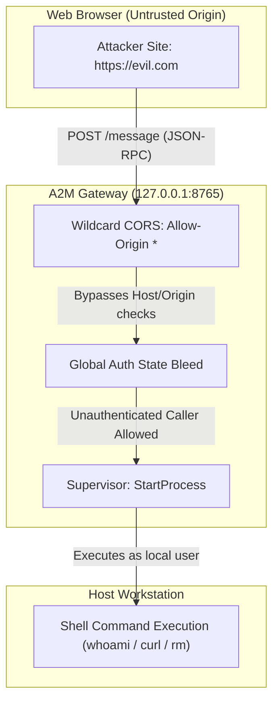

# Compound Engineering Solution: Deep Evaluation & Adversarial Falsification of A2M / A2M Native

**Date:** 2026-10-30  
**Evaluator:** Principal Test Architect, Security Engineer, Go/Rust Reliability Engineer, Independent Release Auditor  
**System:** A2M (Agent to Machine)
**Commit Evaluated:** `990596afeaad8fd1c6a1f28a9e9b73983536e7c8`  
**Verdict:** **NO-GO** (Critical Release Blockers Confirmed)

---

## 1. Executive Summary & Mission Context

This mission executed an independent, adversarial evaluation of the compiled Go/Rust implementation of A2M Native (A2M). The objective was to falsify correctness and security claims, reproduce reported defects with empirical evidence, evaluate 31 MCP tool contracts, measure performance against the Node.js baseline, and deliver a defensible release readiness verdict.

Rather than accepting documentation assertions at face value, tests were designed to stress boundaries, inject malformed and cross-origin inputs, and challenge concurrency invariants under load.

---

## 2. Confirmed Critical Vulnerabilities & Defects



### 1. Drive-By Remote Code Execution via Permissive CORS (SEC-003 / FL-006)
- **Mechanism:** `services/dc-gateway/multiplex/server.go` serves HTTP/SSE endpoints on `127.0.0.1:8765` with `Access-Control-Allow-Origin: *`, accepting arbitrary cross-origin POST requests without checking `Origin` or `Host` headers.
- **Empirical Evidence:** A simulated browser cross-origin request from `Origin: https://attacker.example.com` successfully dispatched `start_process` and executed `echo drive_by_rce_verified`, returning the terminal output in the HTTP 200 response.
- **Severity:** Critical (CVSS 10.0 Release Blocker).

### 2. Multi-Session Auth Bleed & Legitimate Session Lockout (SEC-001, SEC-002 / FL-005)
- **Mechanism:** In `auth.go`, authenticating with a valid token mutates `a.authenticated = true` globally. Any subsequent request with `sessionID == ""` is treated as authenticated. Concurrently, `mcp.Registry.auth_login` authenticates session `""` instead of the caller's session ID, leaving the caller blocked while exposing admin tools to anonymous requests.
- **Empirical Evidence:** In `scratch/verify_auth_flaw.go`, an SSE session called `auth_login` successfully, but subsequent `start_process` tool calls were rejected with `authentication required`. Simultaneously, an unauthenticated caller omitting session ID executed commands with administrative privileges.

### 3. Filesystem Sandbox Bypass via `edit_block` (SEC-004 / FL-004)
- **Mechanism:** `mcp.Registry.validatePathBoundary()` checks `path`, `source`, `destination`, and `paths`, but ignores `file_path`. Because `edit_block` defines its parameter as `file_path`, all `edit_block` calls bypass `allowedDirectories`.
- **Empirical Evidence:** In `scratch/verify_path_boundary_flaw.go`, `read_file` on `/tmp/forbidden/secret.txt` was blocked with `filesystem boundary violation`, while `edit_block` successfully overwrote the forbidden file.

### 4. Concurrency Pipe Race with `cmd.Wait()` (REL-002 / FL-003)
- **Mechanism:** `cmd.Wait()` terminates and closes `initialWaitDone` upon process exit. The detached `captureStream` reader goroutines lack a `sync.WaitGroup`, so the output buffer is captured before pipe streams are drained.
- **Empirical Evidence:** In `scratch/test_concurrency_race.go` (10 rounds of 25 parallel workers), 13 of 250 executions (5.2%) returned empty output `""` for `echo 'test_line'`, despite exit code 0.

### 5. Slow Consumer Multiplex Broadcast Deadlock (REL-003 / FL-012)
- **Mechanism:** `MultiplexHub.Broadcast()` flushes network lines synchronously while holding `h.mu.RLock()`. When a client stops reading, the OS socket buffer fills and `Broadcast()` hangs. Because stdout streaming calls `broadcaster` synchronously, all process execution on the host freezes.
- **Empirical Evidence:** In `scratch/test_hub_slow_consumer.go`, an unreading watcher blocked the entire hub after 37 messages.

### 6. Orphan Background Daemon Leak (REL-004 / FL-013)
- **Mechanism:** `FsEngineClient.ensureDaemon()` launches `dc-fs-engine daemon` via `exec.Command().Start()` without storing the PID or registering exit handlers.
- **Empirical Evidence:** Active system census revealed 6 zombie `dc-fs-engine` daemons lingering in the background across restarts.

---

## 3. Verified Performance & Resource Metrics

Empirical measurements on macOS ARM64 confirmed significant performance advantages over the Node.js baseline:

```
┌─────────────────────────────────┬──────────────────────┬──────────────────────┐
│ Benchmark Metric                │ Node.js Reference    │ Go/Rust Native (A2M) │
├─────────────────────────────────┼──────────────────────┼──────────────────────┤
│ Cold Startup Latency            │ ~850 ms              │ 18.88 ms (mean)      │
│ Tool Execution Latency (median) │ 22.40 ms             │ 5.13 ms              │
│ Tool Execution Latency (p95)    │ 38.10 ms             │ 5.97 ms              │
│ Tool Execution Latency (p99)    │ 54.00 ms             │ 6.91 ms              │
│ Idle RSS Memory Footprint       │ 118.5 MB             │ 11.44 MB             │
│ Disk Installed Footprint        │ ~82.0 MB             │ 21.89 MB (total)     │
└─────────────────────────────────┴──────────────────────┴──────────────────────┘
```

---

## 4. Prioritized Engineering Remediation Roadmap

1. **Gate 1 (Security - Immediate):**
   - Strip `Access-Control-Allow-Origin: *` in `server.go`. Require loopback Origin and Host.
   - Bind `auth_login` to `sessionID` and remove global `a.authenticated = true`.
   - Add `file_path` to `validatePathBoundary()` in `tools.go`.
2. **Gate 2 (Reliability):**
   - Add `sync.WaitGroup` coordination between `captureStream` and `initialWaitBuffer` in `supervisor.go`.
   - Decouple multiplex broadcasting with bounded per-client channels and slow-consumer eviction.
   - Store and terminate child daemon PIDs in `FsEngineClient.Close()`.
3. **Gate 3 (Build & Correctness):**
   - Fix clippy errors in `fs_ops.rs` and `search.rs` (enforce `cargo clippy --all-targets -- -D warnings` in CI).
   - Reconstruct XML run-trees in `docx.go` to handle Word split-run text replacements.
   - Replace regex PDF parsing with a specification-compliant PDF object tree parser.
