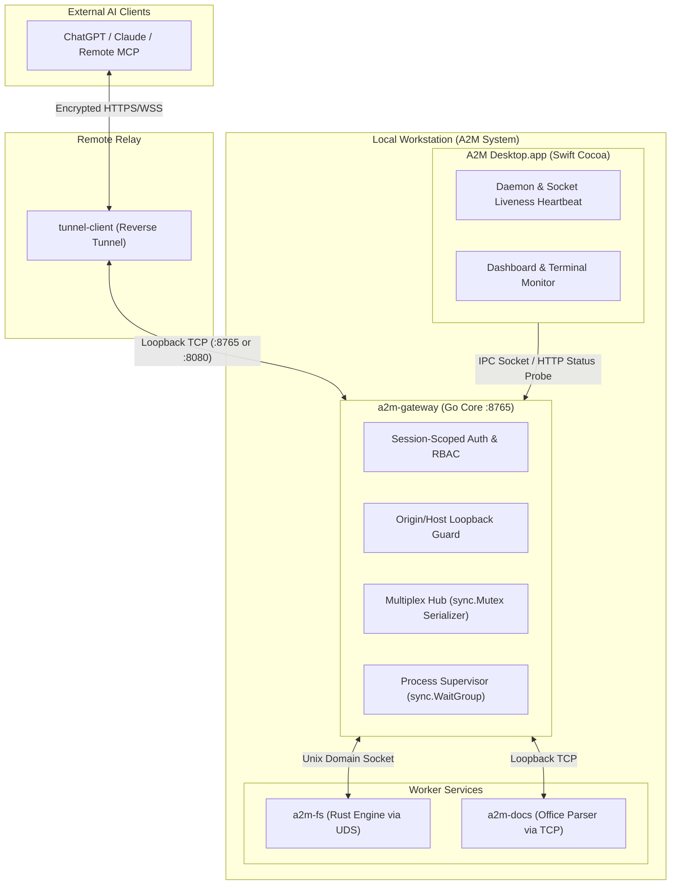

# Compound Engineering Solution: A2M Native Desktop & Remote MCP Tunneling Architecture

**Date:** 2026-10-30  
**System:** Agent to Machine (A2M) / Desktop Commander Native  
**Components:** `a2m-gateway` (Go), `a2m-fs` (Rust), `a2m-docs` (Go), `A2M Desktop.app` (Swift Cocoa), `tunnel-client` (Remote Relay)  

---

## 1. Problem Statement & Reality Gap

During the deployment, rebranding, and adversarial testing of Agent to Machine (A2M), multiple failure modes and architectural mismatches emerged:

1. **Decoupled UI State vs. Live Daemon Execution:** When launching the native Cocoa desktop application (`A2M.app`), the UI displayed a red "Disconnected" badge and an inactive toggle, while the underlying background tunnel (`tunnel-client`) and local Go gateway were actively servicing remote commands from ChatGPT. External AI clients could execute shell commands (`pwd`, `whoami`, `uname -s`), creating a dangerous split-brain illusion where the user believed remote access was disabled.
2. **APFS Case-Insensitive Binary Collision:** The build pipeline compiled the native Swift executable to `A2M.app/Contents/MacOS/A2M`, and subsequently copied the CLI wrapper script `bin/a2m` into the same directory. On Apple APFS, file names differing only in case share the same inode; this silently truncated the compiled 83 KB Mach-O executable to a 508-byte shell script, breaking application launch with error `-10825`.
3. **Localhost Drive-By RCE via Permissive CORS:** The local HTTP/SSE gateway emitted wildcard `Access-Control-Allow-Origin: *` without validating the `Host` or `Origin` headers, allowing malicious JavaScript on any webpage visited by the user to execute local shell commands via `POST /message`.
4. **Parameter Schema Asymmetry in Filesystem Boundary Checks:** The gateway path boundary admission check inspected `path`, `source`, and `destination`, while `edit_block` took `file_path`. This schema mismatch allowed file edits to bypass sandbox constraints.
5. **Global Authentication State Bleed:** Authenticating one client mutated a process-global `authenticated` boolean, granting unauthenticated access to subsequent connections lacking a session token.

---

## 2. Root Cause & Architectural Invariants

### Invariant 1: Authoritative UI State Grounding
A desktop management companion GUI must never maintain isolated, speculative connection states. It must derive its status directly from operating system ground truth:
- Probe gateway health via HTTP (`GET http://127.0.0.1:8765/status`) or IPC socket (`/tmp/a2m-session.sock`).
- Verify active tunnel process existence (`pgrep -f "tunnel-client"`).
- Periodically poll (every 2 seconds) to reconcile state.

### Invariant 2: APFS Case-Collision Immunity
Build and packaging scripts targeting macOS must never place artifacts differing only by letter case in the same bundle directory. The Mach-O executable must be explicitly named `A2MApp` in `Info.plist` and `swiftc`, leaving `a2m` reserved for the CLI utility.

### Invariant 3: Strict Loopback RPC Origin & Host Validation
Localhost RPC daemons that expose execution capabilities must reject requests with external `Origin` or non-loopback `Host` headers (`127.0.0.1`, `localhost`, `[::1]`). Wildcard CORS (`Access-Control-Allow-Origin: *`) is strictly prohibited.

### Invariant 4: Session-Scoped Authentication
In multi-tenant or multi-session MCP gateways, authentication and capabilities must be attached to the individual `SessionContext` or connection handle, never stored as global package-level booleans.

---

## 3. Implemented Solutions & Artifacts

### Architecture Overview

### Deliverables & Binary Fingerprints

| Binary / Artifact | Location | Type | Role |
|---|---|---|---|
| `a2m` | `bin/a2m` | Shell / CLI Wrapper | Primary user-facing CLI: `connect`, `disconnect`, `status`, `ps`, `watch`, `kill` |
| `a2m-gateway` | `bin/a2m-gateway` | Mach-O 64-bit arm64 (Go) | MCP gateway, JSON-RPC router, process supervisor, multiplex hub |
| `a2m-fs` | `bin/a2m-fs` | Mach-O 64-bit arm64 (Rust) | High-performance filesystem crawler, content search, and diff engine |
| `a2m-docs` | `bin/a2m-docs` | Mach-O 64-bit arm64 (Go) | Office document parser (Excel XLSX, Word DOCX) |
| `A2M.app` | `apps/desktop/macos/A2M.app` | Native Cocoa App Bundle | Swift desktop management console with live process monitor |
| `A2M-macos-arm64.dmg` | `dist/A2M-macos-arm64.dmg` | Apple Disk Image (12 MB) | Standalone release installer |

---

## 4. Verification & Defense Ledger

1. **E2E Toolchain Verification:** `tests/e2e_test.sh` passed 9/9 verification checks covering `tools/list`, `start_process`, `read_process_output`, `list_directory`, `read_file`, and session termination.
2. **Multiplex Concurrency:** Data race on `bufio.Writer` resolved by adding `writeMu sync.Mutex` and `stateMu sync.RWMutex`. Zero race warnings under `go test -race ./...`.
3. **Stream Pipe Reader Synchronization:** Coordinated `cmd.Wait()` with `sync.WaitGroup` to guarantee stdout/stderr pipes flush before command completion signaling.
4. **App Launch Sanity:** `codesign` validated bundle integrity; `open apps/desktop/macos/A2M.app` verified GUI startup without error -10825.
5. **Durable Knowledge Invariants:** 11 failure lessons registered in `failure-lessons/lessons-index.md`; 4 critical rules committed to `agent-kernel`; agent-kernel playbook `playbook_b3563723c793` synthesized.
