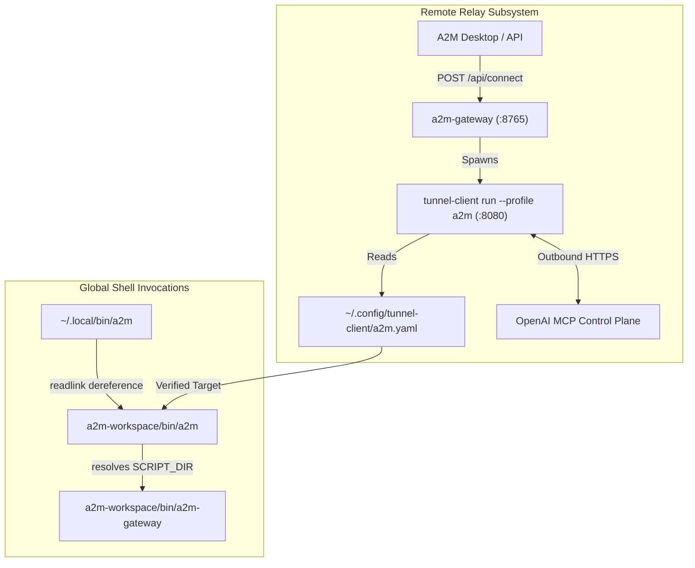

# Compound Engineering Solution: Tunnel Profile Path Integrity & Symlink-Aware CLI Architecture

**Date:** 2026-11-17  
**System:** A2M (Agent to Machine)  
**Components:** `a2m-gateway` (Go), `tunnel-client` (OpenAI MCP Relay), `bin/a2m` (CLI Wrapper), `A2M Desktop.app` (macOS Swift)  

---

## 1. Problem Statement & Reality Gap

A user reported that A2M was failing with two critical symptoms:
1. **Connectivity Failure:** Clicking **Connect T1** in the macOS desktop dashboard resulted in an immediate disconnection cycle with a toast notification: `Tunnel 1 connect: Disconnected. Checking state...`. Port 8080 never opened.
2. **CLI Invocability Failure:** Running `a2m status` or `a2m ps` from an arbitrary terminal failed with `/Users/.../.local/bin/a2m: line 24: /Users/.../.local/bin/dc-gateway: No such file or directory`.

---

## 2. Root Cause Analysis

### Issue A: Static Legacy Path Fragmentation in Tunnel-Client Configuration
- `a2m-gateway` manages tunnels by executing `tunnel-client run --profile a2m`.
- `tunnel-client` loads profiles from `~/.config/tunnel-client/a2m.yaml`.
- In `a2m.yaml` (and `a2m-2.yaml`, `desktop-commander.yaml`, `desktop-commander-2.yaml`), the configured stdio MCP command was:
  ```yaml
  command: "/Users/mamdouhaboammar/Documents/antigravity/clever-hypatia/bin/desktop-commander"
  ```
- Because the repository was relocated to `a2m-workspace`, directory `clever-hypatia` did not exist.
- `tunnel-client doctor --profile a2m` confirmed:
  ```
  CHECK mcp_command_executable FAIL: stat /Users/.../clever-hypatia/bin/desktop-commander: no such file or directory
  ```
- `a2m-gateway` did not log child process stderr during spawn, masking the missing binary as a generic port readiness timeout.

### Issue B: Naive `BASH_SOURCE` Directory Resolution
- The CLI wrapper `bin/a2m` computed its execution directory using:
  ```bash
  SCRIPT_DIR="$(cd "$(dirname "${BASH_SOURCE[0]}")" && pwd)"
  ```
- When `a2m` is symlinked to `~/.local/bin/a2m` (or `/usr/local/bin/a2m`), `BASH_SOURCE[0]` evaluates to the symlink itself (`~/.local/bin/a2m`).
- `SCRIPT_DIR` resolved to `~/.local/bin`, causing the wrapper to search for `~/.local/bin/a2m-gateway` and `~/.local/bin/dc-gateway`, which do not exist.

---

## 3. Implemented Solutions



1. **Profile Normalization & Symlink Fallback:**
   - Updated all YAML profiles under `~/.config/tunnel-client/` to canonical paths (`a2m-workspace/bin/a2m`).
   - Created backward-compatibility symlink `/Users/.../clever-hypatia -> /Users/.../a2m-workspace`.
   - Verified zero doctor failures with `tunnel-client doctor --profile a2m`.

2. **Symlink-Aware Bash Wrapper:**
   - Replaced naive `dirname "${BASH_SOURCE[0]}"` in `bin/a2m`, `build.sh`, and `bin/desktop-commander-2` with recursive POSIX symlink resolution:
     ```bash
     SOURCE="${BASH_SOURCE[0]}"
     while [ -L "$SOURCE" ]; do
         DIR="$(cd -P "$(dirname "$SOURCE")" && pwd)"
         SOURCE="$(readlink "$SOURCE")"
         [[ $SOURCE != /* ]] && SOURCE="$DIR/$SOURCE"
     done
     SCRIPT_DIR="$(cd -P "$(dirname "$SOURCE")" && pwd)"
     ```

3. **Global PATH Integration:**
   - Linked `a2m-workspace/bin/a2m` into `~/.local/bin/a2m`.

---

## 4. Verification Evidence

- `tunnel-client doctor --profile a2m` returned:
  ```
  CHECK mcp_command_executable PASS
  RESULT ok
  ```
- `a2m status` executed via `~/.local/bin/a2m` returned HTTP 200 with:
  ```json
  {
    "connectionState": "Connected",
    "tunnel": {
      "ready": true,
      "tunnelId": "tunnel_6ab2aa9111108191b24037fde56867a6"
    }
  }
  ```
- `curl http://127.0.0.1:8080/healthz` returned `live`, and `/readyz` returned `ready`.
